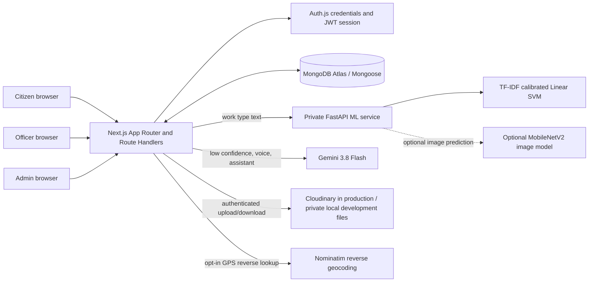

# CivicGuard AI: Technical Project Presentation

**Project:** AI-Based Municipal Grievance Portal  
**Product name:** CivicGuard AI  
**Document purpose:** Project presentation, implementation reference, and verification record  
**Verified:** 2 October 2026

## 1. Executive Summary

CivicGuard AI is a web portal for registering, triaging, assigning, tracking, and resolving municipal complaints. Citizens submit issue descriptions, optional landmarks/GPS, and evidence. A local text classifier suggests one of seven work types. Low-confidence or unavailable local predictions are sent to Gemini 3.8 Flash for a structured fallback. Centralized routing maps work types to municipal categories and departments. Active department officers can be assigned according to workload, accept the work, and record a resolution. Citizens can follow the audit timeline and rate completed work.

The application is built as a Next.js App Router full-stack application. MongoDB Atlas (via Mongoose) stores accounts, complaints, uploads, departments, notifications, and complaint history. A private FastAPI service hosts the local text model and optionally hosts image inference. The application remains usable when optional AI or image services are unavailable: the complaint is stored first, and image failure does not block text analysis.

## 2. Problem and Outcomes

Municipal reports are often split across phone calls, email, social media, and walk-in channels. This fragments status visibility, delays routing, obscures repeated reports, and weakens accountability.

The portal provides:

- A single, trackable channel for resident reports.
- Citizen-visible status and activity history.
- An officer queue limited to work assigned to that officer.
- An administrator view across municipal records, departments, staff, and analytics.
- AI-assisted, human-reviewable routing rather than automated final decisions.
- GPS-aware related-report signals without deleting or merging citizen submissions.
- Resolution evidence and post-resolution citizen feedback.

## 3. Scope and Non-Goals

### In scope

- Email/password authentication for citizens, officers, and administrators.
- Citizen complaint submission, tracking, profile, uploads, voice transcript analysis, and feedback.
- Officer assignment acceptance/decline, lifecycle updates, resolution notes/evidence, and reports.
- Administrator officer and department management, analytics, heatmap, assignments, and PDF reports.
- Local-first work-type inference, validated Gemini fallback/chat/voice workflows, and related-report scoring.

### Not implemented as a guaranteed production feature

- Email verification, OTP/MFA, or password reset.
- Durable local-disk storage in production; local storage is development-only.
- A checked-in or currently loaded image-classification artifact.
- SMS, email, or push notification delivery; notifications are in-app.
- Emergency dispatch, cross-municipality data sharing, or autonomous complaint rejection.

## 4. System Architecture



### Runtime responsibilities

| Layer | Responsibility |
| --- | --- |
| Browser UI | Citizen, officer, and admin pages; form validation; map/chart rendering; no trusted authorization decisions. |
| Next.js server | Pages, API validation, session and role checks, complaint persistence, orchestration, report generation, upload authorization. |
| Auth.js | Credentials provider, bcrypt verification, JWT session, session cookie. |
| MongoDB | Durable account/complaint state, geospatial index, departments, upload metadata, notifications, and audit events. |
| FastAPI service | Private text inference and optional image inference. The text model is loaded at process startup. |
| Gemini API | Structured fallback when local confidence is insufficient, voice-transcript extraction, and authenticated assistant answers. |
| Cloudinary/local private storage | Binary file storage. Local files stay outside `public/` and require the authenticated media route. |
| Nominatim | Reverse geocoding only after a citizen chooses to capture GPS. |

## 5. Technology Stack

- **Frontend/full-stack:** Next.js 16 App Router, React 19, TypeScript, Tailwind CSS.
- **Authentication:** Auth.js / NextAuth credentials provider, JWT strategy, bcryptjs.
- **Persistence:** MongoDB and Mongoose.
- **Validation:** Zod at request and AI-output boundaries.
- **Text ML:** scikit-learn TF-IDF, calibrated Linear SVM, joblib artifact.
- **ML API:** FastAPI, Uvicorn, Pydantic, NumPy, Pillow.
- **Optional image ML:** TensorFlow/Keras and MobileNetV2 transfer learning.
- **Generative AI:** `@google/generative-ai`, configured with `GEMINI_MODEL` (verified with `gemini-3.8-flash`).
- **Maps/charts:** Leaflet/React Leaflet and Recharts.
- **PDF:** Server-generated municipal work report.

## 6. User Roles and Authorization

The server derives role and active state from the stored user record. Client-supplied role, ownership, department, priority, category, or AI claims are not authorization sources.

| Capability | Citizen | Officer | Administrator |
| --- | --- | --- | --- |
| View own profile and notifications | Yes | Yes | Yes |
| Submit complaint | Yes | No | No |
| List complaints | Own complaints | Assigned complaints | All complaints |
| Read complaint detail | Own only | Assigned only | All |
| Accept/decline assignment | No | Assigned pending work | No |
| Update complaint lifecycle/resolution | No | Assigned and accepted work | Municipal-wide |
| Assign/reassign officer | No | No | Yes |
| Manage officers/departments | No | No | Yes |
| View analytics/heatmap | No | Assigned-scope heatmap | Municipal-wide analytics |
| Submit feedback | Own complaint after resolution | No | No |
| Download work report | No | Own report | Overall or selected-officer report |

### Enforcement details

- Private API handlers call `requireUser`, often with an explicit allowed-role list.
- `requireUser` reloads the account and checks that it is active.
- Citizen complaint access compares the complaint's citizen ID with the session user ID.
- Officer complaint access compares the assigned officer ID with the session user ID.
- A pending officer assignment must be accepted before the officer can update the complaint lifecycle.
- Only administrators can assign officers; only active officer records are assignable.
- File retrieval returns 404 when the requester is not the owner, assigned officer, or an administrator.
- State-changing browser routes validate the request origin and apply endpoint-specific rate limits.

## 7. Pages and User Workspaces

| Path | Purpose |
| --- | --- |
| `/` | Portal entry page. |
| `/register` | Citizen registration: username, mobile number, email, password, confirmation. |
| `/login` | Email/password sign-in. |
| `/dashboard` | Citizen overview; redirects staff to their role workspace. |
| `/complaints` | Citizen-owned, officer-assigned, or admin-wide complaint list according to role. |
| `/complaints/new` | Citizen complaint creation, optional GPS, voice input, file upload. |
| `/complaints/[id]` | Complaint details, AI assessment, timeline, staff controls, citizen feedback. |
| `/profile` | Read-only email/mobile and editable display name. |
| `/officer` | Officer workload, priority queue, map, and report export. |
| `/admin` | Municipal analytics, charts, hotspots, performance, and feedback. |
| `/admin/officers` | Officer and department management. |

### Lifecycle values

Complaint status values are `SUBMITTED`, `ASSIGNED`, `IN_PROGRESS`, `RESOLVED`, `CLOSED`, `REOPENED`, `REJECTED`, `DUPLICATE`, and `ESCALATED`. Assignment status is separately represented as `UNASSIGNED`, `PENDING`, `ACCEPTED`, or `DECLINED`.

The common workflow is:

```text
SUBMITTED -> ASSIGNED/PENDING -> IN_PROGRESS/ACCEPTED -> RESOLVED -> CLOSED
```

Declined work returns to an unassigned submitted state for reassignment. Administrators can reassign work. Every meaningful update appends a history event with actor, timestamp, previous/new values, and optional remarks.

## 8. Server API Surface

| Method and path | Access | Purpose |
| --- | --- | --- |
| `GET, POST /api/auth/[...nextauth]` | Public Auth.js protocol; POST rate-limited | Credentials sign-in/session flow. |
| `POST /api/register` | Public, origin/rate limited | Validate and create a citizen account. |
| `GET, PATCH /api/profile` | Signed in | Read profile; update display name. |
| `GET, POST /api/complaints` | GET: signed in, role-scoped; POST: citizen | List visible reports; save a new report and schedule background work. |
| `GET, PATCH /api/complaints/[id]` | GET: owner/assignee/admin; PATCH: officer/admin | Read or update an authorized complaint. |
| `POST /api/complaints/[id]/analyze` | Officer/admin; officer must be assigned | Retry AI analysis and duplicate detection. |
| `POST /api/complaints/[id]/feedback` | Owning citizen, resolved complaint | Save a 1-5 rating and comment. |
| `GET /api/complaints/heatmap` | Officer/admin | Return role-scoped geospatial features and summary counts. |
| `GET /api/analytics` | Admin | Municipal-wide aggregate metrics. |
| `GET, POST, PATCH /api/admin/users` | Admin | List/create officers; update managed user fields. |
| `GET, POST, PATCH /api/departments` | Admin | List/create/update category routing departments. |
| `GET /api/users/officers` | Admin | List active officers for assignment controls. |
| `GET, PATCH /api/notifications` | Signed in, own records only | List notifications or mark them read. |
| `POST /api/uploads` | Signed in | Validate and store JPEG, PNG, or PDF uploads. |
| `GET /api/uploads/[id]` | Owner/assigned officer/admin | Serve private media with no-store headers. |
| `GET /api/location/reverse` | Signed in | Convert explicitly captured coordinates to a readable landmark. |
| `POST /api/chat` | Signed in | Answer portal questions using the current citizen's complaint context; offline fallback is available. |
| `POST /api/complaints/voice-analyze` | Citizen | Extract complaint fields from English/Telugu voice transcript text. |
| `GET /api/reports/pdf` | Officer/admin | Generate a date-filtered officer or municipal PDF report. |

## 9. Persistence Model

MongoDB collections use Mongoose schemas and timestamps.

### User

- `name`: display name/username.
- `email`: required, lowercase, unique sign-in identifier.
- `phone`: required, unique contact number.
- `passwordHash`: bcrypt hash; excluded from normal selects.
- `role`: `CITIZEN`, `OFFICER`, or `ADMIN`.
- `department`: optional officer routing department.
- `active`: server-enforced account switch.
- `avatarUrl`: optional profile media URL.

### Complaint

- Identity/ownership: unique complaint number, citizen reference, description, optional address.
- Location: optional GeoJSON `Point` with `[longitude, latitude]` and optional accuracy. The location subdocument is omitted when GPS is not provided; an empty GeoJSON point is invalid with a 2dsphere index.
- Files: attachments and resolution evidence reference `Upload` records.
- Routing/work: category, department, priority, status, assigned officer, assignment status/timestamps.
- AI: status, confidence, reason, sentiment, summary, image findings, work type, model/version, threshold, fallback flag, timestamps, failure reason.
- Duplicate analysis: possible flag, score, top matches, factor details, optional linked issue.
- Accountability: append-only-style history entries, resolution remarks, feedback rating/comment/timestamp.
- Indexes: unique complaint number; citizen/assignee and lifecycle indexes; `2dsphere` location index; department/status/date compound index.

### Other collections

| Collection | Important fields and relationships |
| --- | --- |
| `Department` | Unique department name, handled categories, active flag. |
| `Upload` | Owner, sanitized filename, MIME, size, storage kind/key. |
| `Notification` | User, optional complaint, kind/title/message, read timestamp. |

## 10. Complaint Processing Pipeline

1. The citizen submits a description, optional address/GPS, and upload identifiers.
2. Zod validates limits and shapes; the server verifies every upload belongs to the citizen.
3. MongoDB durably stores the complaint and initial history event.
4. The API returns HTTP 201 without waiting for remote AI work.
5. Next.js `after()` runs work-type analysis and then duplicate detection.
6. The selected work type maps through `lib/work-types.ts` to a portal category and default department; an active configured department can override the default name.
7. The system picks the least-loaded active officer in that department when available. Assignment remains pending until the officer accepts.
8. Notifications are best-effort and do not undo the complaint or staff decision.
9. Authorized staff can retry failed analysis. Citizens can see report status/history and provide feedback after resolution.

## 11. Work-Type Model and Algorithm

### Model and algorithm inventory

| Feature | Model/algorithm | Runtime status |
| --- | --- | --- |
| Complaint work type | Word unigram/bigram TF-IDF with sublinear term frequency, followed by a calibrated class-balanced LinearSVC | Deployed local model; `work_type_model.joblib`. |
| Trainer comparison | TF-IDF + class-balanced Logistic Regression | Evaluated during training; not the selected production artifact. |
| Low-confidence classification | Gemini 3.8 Flash structured JSON generation, Zod-validated | Active fallback, with bounded retry for transient 429/5xx responses. |
| Complaint images | ImageNet-pretrained MobileNetV2 with frozen convolutional base, augmentation, global average pooling, dropout, and softmax head | Training implementation exists; model/classes artifacts and TensorFlow runtime are absent, so image inference is not active. |
| Related-report text | Jaccard token similarity; cosine similarity is supported if compatible embeddings are present | Jaccard is the current default; the application does not currently generate or persist text embeddings. |
| Related-report location | MongoDB `2dsphere` `$near` query and Haversine distance weighting | Active when a complaint has GPS coordinates. |
| Priority/sentiment | Deterministic safety-pattern and keyword rules | Active heuristics; not trained ML models. |
| Assignment | Least-open-workload selection within the mapped department, with name tie-break | Active deterministic routing algorithm. |

The model is decision support: staff retain control over assignment, lifecycle updates, and resolution. A high classifier score is not proof of real-world accuracy; the recorded evaluation metrics below apply only to the repository's held-out test split.

### Normalization

`normalize_text` applies Unicode NFKC normalization, lowercases, collapses whitespace, and removes punctuation while retaining Unicode letters and digits. This permits Telugu/English examples and keeps training/inference preprocessing consistent.

### Dataset and split

- Dataset source: a sample of public NYC 311 Service Requests taxonomy records plus curated citizen-style and Telugu/English examples.
- Seven balanced labels: Road, Drainage, Garbage, Streetlight, Water, Sanitation, Other.
- Checked-in generated dataset metadata: 504 records, 72 per class.
- Wording variants derived from a source record share a group ID so grouped splits reduce variant leakage.
- Split sizes in the recorded run: 355 training, 70 validation, 79 test.

### Candidate model selection

The trainer compares:

1. Word unigram/bigram TF-IDF with sublinear term frequency + class-balanced Logistic Regression.
2. The same TF-IDF features + class-balanced LinearSVC calibrated with cross-validation.

Macro-F1 on the validation split selects the artifact. The selected calibrated model is refit on train plus validation; the held-out test split is used for final metrics.

### Confidence/rejection policy

The classifier returns probabilities, maximum confidence, selected work type, and a validation-selected threshold. A confidence threshold is preferred over forcing every input into an automatic route. The checked artifact's threshold is 0.60. Predictions below threshold are sent to Gemini; if Gemini is unavailable, analysis can be retried by authorized staff.

### Recorded held-out metrics

| Metric | Recorded value |
| --- | ---: |
| Test accuracy | 0.8861 |
| Macro precision | 0.8878 |
| Macro recall | 0.8849 |
| Macro F1 | 0.8802 |
| Test examples | 79 |

These are metrics on the repository's grouped test split, not a guarantee of field performance. Evaluate on a geographically representative, independently collected municipal test set before operational use.

### Work-type routing table

| Model label | Portal category | Default department |
| --- | --- | --- |
| Road | Road Damage | Roads Department |
| Drainage | Drainage | Drainage Department |
| Garbage | Garbage | Sanitation Department |
| Streetlight | Streetlight | Electrical Department |
| Water | Water Supply | Water Supply Department |
| Sanitation | Sanitation | Sanitation Department |
| Other | Other | Municipal General Department |

## 12. Gemini Integration

- Configured model: `GEMINI_MODEL`; verified value is `gemini-3.8-flash`.
- The API key is read only on the server and must never be sent to browser code or documentation.
- Text fallback asks for one of the seven work types plus confidence and a short reason. The output is parsed and checked against Zod enums and limits before use.
- The assistant receives at most five recent complaints belonging to the signed-in user and has an offline deterministic response path.
- Voice analysis accepts an English or Telugu transcript, returns sanitized description/category/priority/location fields, and degrades to a manual-entry error when the provider is unavailable.
- Transient 429 and 5xx provider errors receive up to three bounded attempts with short exponential delays. A persistent outage still leaves the complaint stored and available for manual review/retry.

Gemini does not make the final assignment, resolution, or complaint deletion decision. Priority/sentiment/summary behavior in complaint processing is currently deterministic and should not be described as a separate generative model output.

## 13. Optional Image Model

The FastAPI `/predict` endpoint expects a Keras model at `MODEL_PATH` and a companion `.classes.json`. The training script uses:

- 224x224 RGB input.
- Image-directory class labels.
- MobileNetV2 pretrained on ImageNet with the base frozen.
- Random flip, rotation, and zoom augmentation.
- Global average pooling, dropout 0.25, and a softmax class head.
- Adam at 0.0001, sparse categorical cross-entropy, batch size 32, default 12 epochs.

**Current verified state:** no image model or classes artifact is checked in; TensorFlow is not installed in the active Python environment. The service lazily imports TensorFlow only when the image artifact exists. `/health` reports `image_model: not_loaded`; `/predict` returns 503. The complaint application now treats image inference as optional, so this condition does not block the text model, routing, or complaint persistence. No image accuracy claim is made.

## 14. Duplicate/Related Complaint Scoring

Duplicate detection only runs when the source complaint has GPS coordinates. MongoDB `$near` and the `2dsphere` index search for up to 15 candidates within `DUPLICATE_DISTANCE_METERS` (default 100 m, clamped to 25-5000 m) and created in the preceding 90 days.

For each candidate, the score is:

```text
score = 0.40 * text
      + 0.15 * image
      + 0.25 * proximity
      + 0.10 * category
      + 0.10 * time
```

- **Text:** cosine similarity when both compatible embeddings exist; otherwise Jaccard similarity over lowercased ASCII alphabetic tokens of length at least three. No embedding-generation model is currently wired into complaint analysis, so Jaccard is the normal runtime path.
- **Image:** Jaccard similarity over image findings when both sides have findings; otherwise a neutral 0.5 factor.
- **Proximity:** `max(0, 1 - distanceMeters / maxDistanceMeters)` using Haversine distance.
- **Category:** exact category match (1) or mismatch (0).
- **Time:** `exp(-ageDays / 30)`.
- Candidates under 0.35 are discarded; remaining matches are sorted and at most five are stored.
- `duplicate.possible` is set when a match meets `DUPLICATE_SCORE_THRESHOLD` (default 0.7).

A match is a review signal only. The system preserves the individual reports and never auto-deletes a citizen submission.

## 15. Priority, Summary, Assignment, and Heatmap Algorithms

### Priority

Priority starts at MEDIUM. Description patterns for immediate hazards (collapse, live electrical wires, fire, electrocution, immediate danger, and specified sewage exposure) force CRITICAL. Other patterns such as accident/injury, school/hospital, overflow/flood, or blocked road raise non-critical priority to HIGH. The current complaint pipeline does not generate LOW from text.

### Sentiment and summary

Sentiment is a bounded keyword pass (`URGENT`, `ANGRY`, frustrated/negative, positive), otherwise NEUTRAL. Summary is whitespace-normalized complaint text truncated to 300 characters. These are operational heuristics, not a trained sentiment or summarization model.

### Least-loaded officer assignment

1. Find active officers whose department matches the complaint's routed department (case-insensitive escaped regular expression).
2. Count each candidate's complaints excluding RESOLVED, CLOSED, and REJECTED.
3. Select the lowest workload; break ties by officer name.
4. Atomically update only a still-SUBMITTED unassigned complaint to ASSIGNED/PENDING.
5. Notify the officer and citizen best-effort.

### Maps and reports

- Admin heatmap groups located complaints into 0.001-degree rounded coordinate/category buckets and highlights groups with at least two reports.
- Heatmap query returns at most 500 records; officers are restricted to their own assignments.
- PDF reports use validated UTC date bounds. Officers can export only their own assigned work; admins can request an overall report or select an officer.

## 16. Security and Privacy Controls

- Passwords are bcrypt hashed (12 rounds); password hashes are excluded from ordinary model queries.
- Email is trimmed/lowercased and unique; mobile numbers are also unique contact fields.
- Auth.js session cookie is HTTP-only, SameSite=Lax, secure in production, with an eight-hour session lifetime.
- Zod schemas are strict for state-changing application payloads, except the Auth.js credentials schema, which accepts provider metadata while validating email/password.
- Same-origin checks protect browser state changes; Auth.js performs its own CSRF validation.
- Request limits are bounded, in-memory, and per Node process. The auth callback allows 30 POST attempts/IP/15 minutes; registration uses 20/IP and 8/email per 15 minutes. Multi-instance deployments require a shared limiter.
- Upload allowlist is JPEG, PNG, PDF; maximum size is 10 MiB. File signatures are checked in addition to declared MIME.
- Local upload bytes are stored outside `public/`; authenticated downloads are private/no-store and use `nosniff`.
- GPS is only requested after citizen action; precise coordinates are restricted to authorized report/map surfaces.
- Gemini and ML calls execute server-to-server. Complaint text is not sent to Gemini when local classification is confident; image bytes are sent only to the optional private image service.
- Prompt inputs are marked as untrusted. Model outputs are constrained by schemas and application-owned category/department mappings.

## 17. Configuration and Operations

| Variable | Purpose |
| --- | --- |
| `MONGODB_URI` | MongoDB connection string. |
| `AUTH_SECRET` | Auth.js JWT/session signing secret. |
| `GEMINI_API_KEY` | Server-only Gemini credential. |
| `GEMINI_MODEL` | Gemini model override; verified as `gemini-3.8-flash`. |
| `ML_WORK_TYPE_MODEL_URL` | Private FastAPI text endpoint, e.g. `http://127.0.0.1:8000/classify-work-type`. |
| `ML_IMAGE_MODEL_URL` | Optional private image endpoint; currently points to `/predict`, but model artifact is absent. |
| `ML_SERVICE_TOKEN` | Optional shared service-to-service token; set identically in both processes when using it. |
| `MODEL_PATH` | Optional Keras image model path. |
| `WORK_TYPE_MODEL_PATH` | Text artifact path; default `artifacts/work_type_model.joblib` in `ml-service`. |
| `CLOUDINARY_CLOUD_NAME`, `CLOUDINARY_API_KEY`, `CLOUDINARY_API_SECRET` | Durable production file storage. |
| `SEED_ADMIN_PHONE`, `SEED_ADMIN_EMAIL`, `SEED_ADMIN_PASSWORD`, `SEED_ADMIN_NAME` | First administrator bootstrap. |
| `DUPLICATE_DISTANCE_METERS` | Nearby-report radius; default 100 m. |
| `DUPLICATE_SCORE_THRESHOLD` | Duplicate flag threshold; default 0.7. |

Never paste a real API key into documentation, source code, logs, or browser code. Rotate the key if it has been exposed.

## 18. Local Setup (Windows PowerShell)

1. Copy `.env.example` to `.env.local`; set MongoDB URI, Auth secret, Gemini key/model, and private service URLs.
2. In a Python environment, install the pinned service dependencies:

   ```powershell
   Push-Location ml-service
   python -m pip install -r requirements.txt
   python -m uvicorn main:app --host 127.0.0.1 --port 8000
   ```

3. In a second terminal, start Next.js:

   ```powershell
   Push-Location ai_based_muncipal_project
   npm install
   npm run dev
   ```

4. Verify ML readiness at `http://127.0.0.1:8000/health`. Text inference must show `work_type_model: loaded`. Image inference remains `not_loaded` until a Keras image artifact and class list have been trained and installed.
5. Seed an administrator only when needed. Supply `SEED_ADMIN_PHONE`, `SEED_ADMIN_EMAIL`, and `SEED_ADMIN_PASSWORD` in the process environment, then run `npm run seed`.
6. Register a citizen at `/register`; create officers from **City overview -> Officer management**.

Run checks from the project root:

```powershell
npm run typecheck
npm run build
Push-Location ml-service; python -m unittest test_text_model.py -v; Pop-Location
```

The project now uses an ESLint 9 flat config with the installed Next presets. `npm run lint` exits successfully; it currently reports 42 warnings, primarily unused catch bindings and hook dependencies in existing UI/API files.

## 19. Verification Record

Checks run in the provided local environment on 2 October 2026. Test accounts, complaints, notifications, upload metadata, and the private test file were removed after the integration checks.

| Area | Result |
| --- | --- |
| `npm run typecheck` | Passed. |
| `npm run build` | Passed; all App Router pages and API routes compiled. |
| Text model unit tests | 3 passed. |
| Text model API | `/health` healthy; Road and Drainage classifications returned 200. |
| Gemini API | `gemini-3.8-flash` request succeeded. Transient 503 high-demand responses occurred; bounded retries were added. |
| Citizen workflow | Registration/login 201/200; profile email; complaint tracking; 5/5 feedback 200. |
| Officer workflow | Admin-created officer 201; sign-in; assigned complaint acceptance 200; resolution update 200. |
| Admin workflow | Admin sign-in; analytics, user/dept lists, officer list, complaints 200; officer creation 201; PDF 200 with `%PDF` signature. |
| Authorization | Citizen cross-user complaint read 403; citizen admin analytics 403; officer admin-only APIs 403. |
| Uploads | Private local upload 201 and authorized download 200. |
| No-GPS complaint | Passed after fixing optional GeoJSON location handling; report saved and analyzed. |
| Image model | Not available: TensorFlow is absent in the active environment and model/class artifacts are not included. `/predict` returns 503 as expected. Image failure no longer blocks text analysis. |
| Python artifact compatibility | Unit tests pass under scikit-learn 1.8.0 with warnings because the artifact was serialized with 1.6.1. Reinstall the pinned requirements for reproducible operation. |
| `npm run lint` | Passed with 0 errors and 42 warnings. |

The tested held-out text model metrics are accuracy 0.8861 and macro-F1 0.8802 on 79 examples. These do not substitute for a real-world pilot or external validation.

## 20. Known Risks and Next Steps

1. Train, validate, and install a municipal image model plus `.classes.json`; keep it private and record per-class precision/recall and confusion matrix.
2. Run training and inference with the same pinned scikit-learn version (1.6.1) used to serialize the checked-in joblib artifact.
3. Replace the in-memory request limiter with a shared store before multi-instance deployment.
4. Add email verification and a secure password-reset flow before public production use.
5. Configure durable private file storage (Cloudinary or equivalent) before production deployment.
6. Migrate ESLint to a supported Next.js 16/ESLint 9 configuration and resolve the existing model-export `any` lint errors.
7. Add repeatable automated integration tests for authorization, upload ownership, assignment transitions, and complaint state transitions.
8. Establish monitoring for Gemini quota/availability, ML endpoint health, background analysis failures, and model drift.

## 21. Demonstration Sequence

1. Register a citizen with username, mobile number, email, password, and confirmation.
2. Submit a road/drainage complaint without GPS to demonstrate that location is optional.
3. Show immediate complaint persistence, then refresh to show AI work type, department, confidence, and assignment.
4. Sign in as the assigned officer, accept the pending assignment, and record a resolution note.
5. Return as the citizen, verify status/history, and submit a rating.
6. Sign in as administrator to show analytics, officer management, department mappings, heatmap, and PDF export.
7. Explain that image inference is optional in this checked-in version and that production use requires a trained artifact.

## 22. Source Map

| Area | Key files |
| --- | --- |
| Auth and data connection | `auth.ts`, `lib/db.ts`, `lib/authorization.ts`, `models/User.ts`. |
| Validation/security | `lib/validation.ts`, `lib/request-security.ts`, `lib/upload-security.ts`. |
| Complaint workflow | `app/api/complaints/`, `components/new-complaint-form.tsx`, `components/complaint-detail.tsx`. |
| AI/routing | `lib/ai.ts`, `lib/work-classifier.ts`, `lib/gemini-retry.ts`, `lib/work-types.ts`, `lib/assignment.ts`. |
| Related reports | `lib/duplicates.ts`, `models/Complaint.ts`. |
| Portal workspaces | `app/dashboard/`, `app/officer/`, `app/admin/`, `components/dashboard-shell.tsx`. |
| ML service | `ml-service/main.py`, `text_preprocessing.py`, `train_text.py`, `train.py`, `test_text_model.py`. |
| Reporting | `app/api/analytics/`, `app/api/reports/pdf/`, `lib/work-report-pdf.ts`. |

## 23. Glossary

- **Work type:** One of the seven model labels used before portal-category mapping.
- **Category:** Portal-facing civic problem classification, such as Road Damage or Water Supply.
- **Department:** Municipal team selected from the central work-type mapping or active admin configuration.
- **Assignment status:** Officer response state, distinct from the complaint lifecycle status.
- **Related/duplicate signal:** A weighted review score; it does not merge or delete reports.
- **Fallback:** Gemini classification used after low local confidence or local service failure.
- **Held-out test split:** Dataset portion excluded from model/threshold selection and used only for the recorded evaluation metrics.
